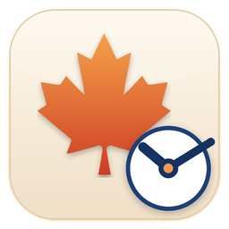

# 时间管理器 · Time-Manager（Android）

<p align="center">
  
</p>

`Time-Maneger`（Windows 桌面版，纯 Win32 + C++）的安卓移植版。功能与界面风格一一对应：同样的双栏布局、同样的月视图 / 周视图、同样的六种分类配色、同样四套主题、同样的三语界面、同样的 Toast 通知与本地数据文件格式。使用 Kotlin + Jetpack Compose 实现，**没有引入 Material 组件库**，所有控件（卡片、按钮、下拉框、复选框、虚线框、周视图方块）都按原版尺寸与配色手绘，因此观感与桌面版保持一致。

## 功能对照

| 功能 | Windows 桌面版 | 安卓版 |
| --- | --- | --- |
| 双栏布局（左月历 + 右活动流） | 固定双栏 | 平板/横屏双栏（≥600dp），手机竖屏上下堆叠 |
| 月视图 / 周视图切换 | 顶部胶囊按钮 | 相同 |
| 月历：今天橙色虚线框、分类底色、4–6 周自适应、点选筛选 | 有 | 有（滚轮 / 方向键翻月改为左右滑动、箭头按钮） |
| 周视图：课表式时间轴、分类彩色方块、重叠分栏、今天高亮、当前时间线 | 有 | 有（触摸拖动手势滚动） |
| 六种分类配色（课程 / 家务 / 工作 / 运动 / 娱乐 / 其他） | 有 | 完全相同的 RGB |
| 分组活动流（日期分组、色点、时间、标题、备注、长文本省略） | 有 | 有 |
| 悬停气泡查看完整信息 | 鼠标悬停 | 触摸端无悬停，点开日程即可看到分类、时间与提醒条数 |
| 单次 / 连续 2–20 周日程 | 有 | 有（每周生成一条独立日程） |
| 批量选择 / 删除（Ctrl 点选、Shift 连选、Ctrl+A、Esc） | 有 | 有（长按进入多选，多选条上提供“全选 / 清空”） |
| 每条日程最多 12 条提醒规则（N 分钟 / 小时 / 天前） | 有 | 有，规则收敛逻辑逐行对齐 `NormalizeRules` |
| 到点通知 | 仿 Win11 Toast 滑入右下角 | 仿原样式的应用内卡片 + 系统通知（含常驻前台服务） |
| 提示音 | 系统提示音 / 蜂鸣 / 自定义 wav | 系统提示音 / 振动 / 自定义音频（SAF 选择文件） |
| 托盘常驻 | 托盘图标 | 前台服务 + 常驻通知 |
| 开机自启 | HKCU\...\Run | BOOT_COMPLETED 广播接收器 |
| 多语言（中文 / 日本語 / English） | 有 | 有，文案表逐条对齐 |
| 四套主题（经典白 / 清新薄荷 / 奶油晨光 / 樱粉初雪） | 有 | 30 个颜色字段完全一致 |
| 本地数据、不联网 | tasks.dat / settings.dat | 相同的 `tasks.dat` / `settings.dat` 文本格式 |

## 界面

与原版一致的设计要点：

- 页面底色取主题的 `page` 色，卡片为白底 + 1px 细边框，圆角 8dp
- 顶部工具条：左侧“月视图 / 周视图”胶囊切换（选中项主题色填充 + 白字），右侧“添加日程 / 删除选中 / 设置”描边按钮；周视图在中间追加 ◀ / 周范围 / ▶ / 本周
- 卡片式分组标题使用主题色文字，分隔线为浅色细线，底部“确定”为主题色填充按钮
- 配色明细见 `app/src/main/java/com/fengshanglinye/timemanager/Theme.kt`（30 个颜色字段与原版 `struct Theme` 顺序一致）

窄屏（手机竖屏）工具条会自动折成两行，避免按钮被挤出屏幕。

布局随屏幕自适应：

- **手机竖屏**：日历卡片在上（高度由内容决定），日程表在下方占满剩余空间；周视图为整屏时间表。
- **横屏 / 平板（宽度 ≥ 600dp）**：恢复桌面版的双栏——日历在左、日程表在右。
- 旋转屏幕不会重建 Activity，选中状态、滚动位置、正在编辑的内容都会保留。

## 环境要求

- JDK 17 或更高（已在 JDK 21 上验证）
- Android SDK：`platforms;android-35`、`build-tools;36.0.0`、`platform-tools`
- Gradle 由仓库自带的 wrapper 提供（8.11.1，国内走腾讯云镜像）
- 最低支持 Android 7.0（API 24），目标 API 34，编译 API 35

## 构建

```powershell
# 按需修改 local.properties 中的 sdk.dir
.\gradlew.bat assembleDebug
```

产物：

```
app\build\outputs\apk\debug\app-debug.apk
```

运行单元测试（纯 JVM，无需设备）：

```powershell
.\gradlew.bat testDebugUnitTest
```

## 安装

```powershell
adb install -r app\build\outputs\apk\debug\app-debug.apk
```

当前已构建好的调试包也放在 `dist\Time-Manager-Android-1.0-debug.apk`，可直接拷贝到手机安装。也可以把 `app-debug.apk` 传到手机上直接点开安装（需允许“安装未知来源应用”）。

首次启动时请允许“通知”权限；Android 12 及以上还需要“闹钟与提醒”权限，否则提醒只能在前台服务存活时触发。设置里开启“开机时自动启动”后，重启手机会自动恢复提醒调度。

## 使用

1. 点“添加日程”，选择开始 / 结束日期时间（精确到分钟），填写标题、分类、备注
2. “重复”可选“单次日程”或“每周重复，连续 2–20 周”
3. “提醒规则”默认 提前 1 天 / 1 小时 / 30 分钟 / 5 分钟，可自行增删（最多 12 条）
4. 月视图点某一天可筛选当天日程，再点一次取消筛选
5. 长按某条日程可多选，配合“删除选中”批量删除
6. “设置”里可切换语言、界面皮肤、通知停留时长、提示音、开机自启

## 数据与隐私

- 数据保存在应用私有目录：`/data/data/com.fengshanglinye.timemanager/files/`
  - `tasks.dat`：日程（与桌面版**逐字节兼容**的文本格式，可直接与 Windows 版互换）
  - `settings.dat`：设置（`autostart|minStart|sound|toastSec|wavPath|lang|theme`）
- 不联网、无遥测、不上传任何数据
- 备份：导出上面两个文件即可；清空日程则删除 `tasks.dat`

`tasks.dat` 格式（与桌面版一致）：

```
<日程数> <下一个 ID>
T|id|分类|开始年|月|日|时|分|结束年|月|日|时|分|标题|备注
R|规则数|分钟|是否已提醒|分钟|是否已提醒...
```

同时兼容桌面版更早的“17 字段 + 4 条固定提醒”旧格式。

## 项目结构

```
app/src/main/java/com/fengshanglinye/timemanager/
  MainActivity.kt      主界面装配、状态、布局（宽屏双栏 / 窄屏堆叠）
  Model.kt             数据结构 Task / Reminder / Settings、分类常量、AppState
  Theme.kt             四套主题的 30 个颜色字段 + 排版常量（对齐原版 struct Theme）
  Strings.kt           中文 / 日本語 / English 三语文案表
  Store.kt             tasks.dat / settings.dat 读写、提醒规则收敛（对齐 NormalizeRules）
  CalendarCard.kt      左侧月历卡片（含今天虚线框、分类底色、色点）
  WeekGrid.kt          周视图时间轴（分栏、今天高亮、当前时间线、滚动）
  AppUi.kt             工具条、活动流、Toast 堆叠、底部状态栏
  AddTaskDialog.kt     添加 / 编辑日程窗口
  SettingsDialog.kt    设置窗口、确认框、提示条
  Widgets.kt           手绘控件库（卡片 / 按钮 / 下拉 / 复选框 / 细线…）
  Reminders.kt         通知渠道、闹钟调度、提示音（文件末尾含 ReminderReceiver 到点广播）
  ReminderService.kt   前台服务（对应桌面版“托盘常驻”；文件末尾含 BootReceiver 开机自启）
app/src/test/java/...  纯 JVM 单元测试（数据格式、规则收敛、跨天时段、周视图分列）
app/src/main/res/      图标、字符串、主题
docs/                  README 使用的图标
```

## 与桌面版的差异

- 桌面版“悬停气泡”在触摸设备上没有等价物，分类 / 时间 / 提醒条数改为点开日程在编辑窗口里查看；长按则用作多选入口，选中后活动流顶部出现“已选 N 个日程 / 全选 / 清空”辅助条（对应 Ctrl+A 与 Esc）
- 桌面版关闭窗口最小化到托盘；安卓版改为前台服务 + 常驻通知（点通知回到应用）
- 自定义提示音从 `.wav` 路径改为系统文件选择器（`OpenDocument`），保存持久化 URI
- 桌面版支持键盘快捷键（Ctrl+A / Esc / 方向键切换月份）；安卓版以长按多选、多选辅助条、左右滑动翻月替代

## 验证情况

- `.\gradlew.bat assembleDebug` 通过，APK 已产出。
- `.\gradlew.bat testDebugUnitTest` 通过，共 **44 个测试**：
  - `CoreLogicTest`（19 个）：`tasks.dat` 序列化 / 解析、旧版 17 字段格式、非法字段兜底、提醒归一化、跨天时段、周视图分列、`mondayOf`、多语言月份标题、提前时间文案。
  - `WeekGridLayoutTest`（6 个）：用 Robolectric 在宿主机上真实测量 Compose 布局——24 小时内容必须是 1440dp、7 列必须都是整天高度且不重叠、可滚动范围必须大于视口的 30%、默认停在 7:00 且上滑能继续移动、21:00 的日程块必须正好落在 21 点线上。这组测试就是针对“只有 0–7 点 / 7 点后排版乱 / 拖不动”这三个真机问题加的回归。
  - `LaunchTest`（1 个）：先写入 7 个覆盖每个星期几的日程 + 未来 / 过去 / 正在进行各一条，然后连续启动两次并 `recreate()`，专治“打开一次之后打不开”。
  - `WeekdayLabelTest`（2 个）：七个星期几的分组标题都要能取到，且中 / 日 / 英三语星期名正确。
  - `StringsTest`（4 个）：三语文案的占位符必须一致、不缺语言、格式化不抛异常。
  - `AppSmokeTest`（1 个）：在 411×891dp 手机尺寸下组合整个 `AppRoot`（工具栏 + 月历 + 活动流 + 弹窗层），确认不崩溃、根节点尺寸正确。
  - `AddTaskDialogLayoutTest`（5 个）：在 320dp / 300dp / 411dp 三种手机宽度下真实测量「添加日程」对话框——日期框必须装得下 `2026/10/26`、分类控件不能被「重复」挤成 0 宽、任何控件都不能越过对话框右边缘。这组测试针对真机截图里「日期显示成 2026/…」「分类和重复叠在一起」「提醒规则按钮被切掉」三个问题。
  - `PortraitLayoutTest` / `SmallPhoneLayoutTest` / `LandscapeLayoutTest` / `SmallLandscapeLayoutTest`（5 个）：分别在 411×891dp、320×640dp 竖屏和 891×411dp 横屏下真实测量主界面——竖屏日历必须在日程表上方、日历高度不得超过屏幕 62%、日程表必须保留可读高度；横屏必须恢复「日历在左 340dp、日程在右」的双栏。这组就是“竖屏下日历把整屏吃光、日程表被挤没”的回归。
- 说明：本机无法启动安卓模拟器（AVD 卡在启动阶段），所以**像素级的观感仍建议在真机上确认**；上面这组宿主机布局测试覆盖的是尺寸、位置、滚动这类可以用代码断言的部分。

## 更新记录

**1.0.4**

- 竖屏周视图也显示日历了：与月视图一致「日历在上、时间表在下」，不再只有一块时间表。
- 修复周视图表头出现两个「周六」：表头按 ISO 1..7 取星期名，第 7 天被 `coerceIn(0,6)` 钳成 6（周六）。改成对 7 取模，周日回到「日 / Sun / 日」。
- 修复横屏日期数字显示不全：格子被压到 26dp 左右时，数字字号（13sp→10.5sp）、上边距（6dp→1dp）、圆点半径与底部间距全部自适应收缩，短横屏（360dp 高）也能完整显示。
- 新增 `SmallLandscapeLayoutTest`（矮横屏 740×360dp）与星期表头回归（`isoIndexSevenIsSunday`、`weekHeaderHasSevenDistinctLabels`）。

**1.0.3**

- 同时支持横屏与竖屏（`configChanges` 已声明，旋转不重启 Activity）：
  - **竖屏**：日历在上方、日程表在下方。日历格子按屏幕宽度自适配（320dp 窄屏约 38dp 一格），整张日历卡片由内容决定高度，不再把整屏吃光；下方日程表占满剩余空间。
  - **横屏 / 平板（宽度 ≥ 600dp）**：与桌面版一致的双栏——日历在左（340dp）、日程表在右；周视图右侧为时间表。
- 新增 `PortraitLayoutTest` / `SmallPhoneLayoutTest` / `LandscapeLayoutTest`（4 条）在宿主机上实测横竖屏布局。

**1.0.2**

- 修复「添加日程」里日期显示成 `2026/…`：左侧标签宽度从 76dp 收到 50dp、时间框从 96dp 收到 74dp、对话框与卡片内边距各减 2–4dp，日期框在 360dp 宽的手机上从 48dp 变成 154dp，`2026/10/26` 可完整显示。
- 更窄的屏幕（320dp 及以下）或系统字体放大时，「开始 / 结束」自动折成「日期一行、时间一行」，日期永远拿满整行宽度。
- 修复「分类」控件被「重复」挤成 0 宽、两块内容叠在一起：分类与重复改为各占一行。
- 修复「提醒规则」那一行 `[15][分钟][添加规则][删除选中]` 在手机上被挤出对话框：宽度不足 300dp 时自动分两行。
- 设置窗口同步收窄内边距，提示音下拉在窄屏上不再被「试听」按钮挤掉，改为上下排布。
- 新增 `AddTaskDialogLayoutTest`（5 条）在宿主机上实测上述尺寸。

**1.0.1**

- 修复“打开一次之后就打不开了”：月视图活动流的分组标题用 `S(Str.WEEK_SHORT).split('|')[星期]` 取星期名，而 `S()` 返回的已经是单个星期名，于是周一至周六都会抛 `IndexOutOfBoundsException` 闪退（周日恰好不闪）。改用 `weekShort()`，并补上 `WeekdayLabelTest` 回归。
- 修复切换到 English 时崩溃、切换到日本語时显示英文星期名：`WEEK_SHORT` 少了日本語那一组，扁平表只有 14 项。同时给 `Str.at()` / `Str.day()` 加了越界兜底，同类问题不会再崩。
- 修复周视图只有 0:00–7:00、7 点之后排版错乱、拖不动：滚动容器改用 `verticalScroll`，子内容高度不再被视口约束压缩，并补上 `WeekGridLayoutTest` 6 条布局回归。

**1.0**

- 首次发布：月视图 / 周视图、日程增删改、每周重复、提醒规则、通知与提示音、四套主题、三语界面、`tasks.dat` / `settings.dat` 与原版互通。

## 一键发布

项目根目录的 `release.ps1` 会一次性完成：升版本号 → 跑单元测试 → 打包 APK → 拷贝到 `dist\` → 提交并推送。

```powershell
cd $env:USERPROFILE\Desktop\Time-Manager-Android
.\release.ps1 -Version 1.0.4 -Message "1.0.4：修复 XXX"
```

- `versionCode` 自动 +1，不用手动改
- 推送默认绕过本机 git 全局代理（`http://127.0.0.1:12000`，代理没开时直连 github）
- 脚本带 UTF-8 BOM，Windows PowerShell 5.1 与 PowerShell 7 都能正确显示中文

## 制作人员

- 原作者：枫殇林叶（Windows 版 `Time-Maneger`）
- 邮箱：3507609128@qq.com
- 应用图标沿用原项目作者绘制的图标

## License

[MIT](LICENSE)
